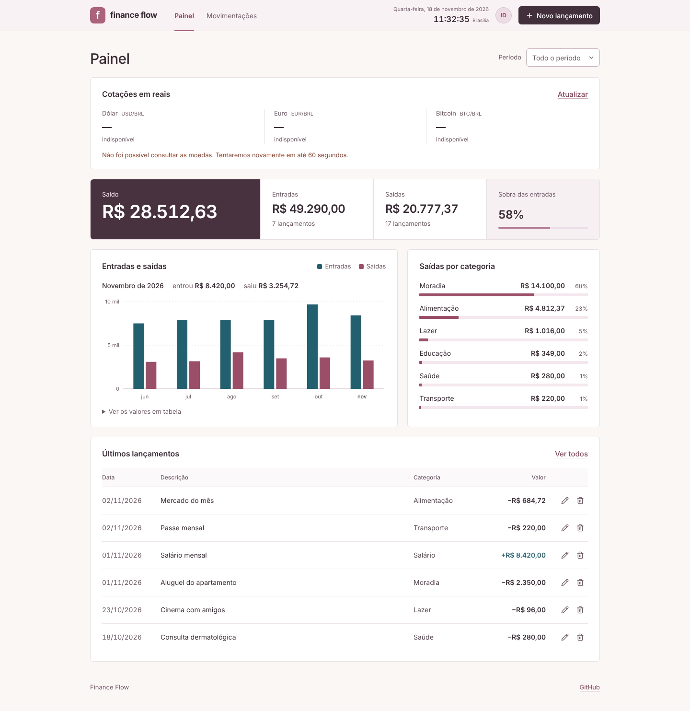
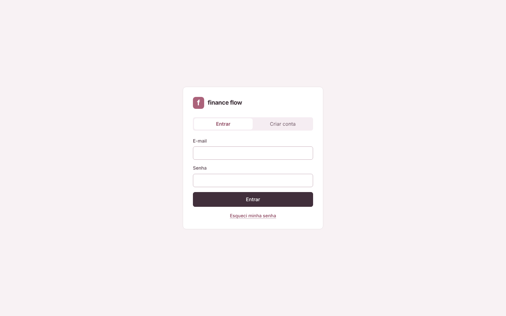
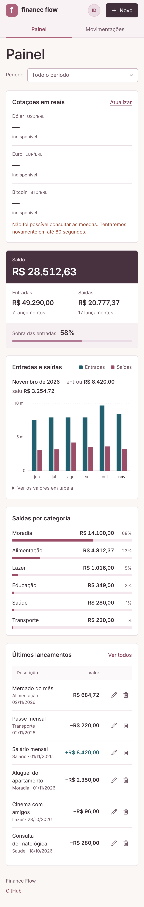

# Finance Flow

Controle financeiro pessoal com conta para cada pessoa: entradas, saídas, saldo por período, saídas por categoria e cotações do dólar, euro e bitcoin em reais.

Feito em **React + TypeScript** com **Supabase** (autenticação e banco PostgreSQL). Cada usuário cria a própria conta e vê só os próprios lançamentos — não existe administrador.

**[Abrir o site](https://isadorabdrong.github.io/FinanceFlow/)** · por [Isadora Drong](https://www.linkedin.com/in/isadora-drong/)



| Entrar / criar conta | Celular |
| --- | --- |
|  |  |

## Funcionalidades

- Cadastro com e-mail e senha, login, recuperação de senha e edição do nome.
- Cadastrar, editar e excluir lançamentos (com confirmação antes de excluir).
- Um único filtro de período no painel que vale para os totais, o gráfico, as categorias e a lista.
- Busca e filtros por tipo, categoria e período; exportação em CSV.
- Cotações em reais (AwesomeAPI e Binance), com fonte e horário de cada valor. Se a fonte falhar, aparece “indisponível” — nenhum valor é inventado.
- Relógio no horário de Brasília.

## Segurança dos dados

A tabela `transactions` usa **Row Level Security** no PostgreSQL: as políticas só permitem ler, criar, editar e excluir linhas em que `user_id` é o usuário logado. Visitantes sem login não têm acesso à tabela. Os valores são guardados em **centavos inteiros** (`amount_cents`) para evitar erro de arredondamento. O SQL está em [`supabase/migrations`](supabase/migrations/001_transactions.sql).

A chave usada no front é a *publishable key* do Supabase, feita para ficar pública: o que ela pode fazer é limitado pelas políticas RLS.

## Rodar no computador

Requisitos: Node 20+.

```bash
npm install
npm run dev      # http://localhost:5173
npm test         # regras financeiras e validação das cotações
npm run build    # gera dist/index.html
```

Para usar outro projeto Supabase, copie `.env.example` para `.env`, preencha a URL e a chave e rode a migration da pasta `supabase/migrations`.

## Estrutura

```
src/
  App.tsx                     login → painel e movimentações
  components/auth-screen      entrar, criar conta, recuperar senha
  components/monthly-chart    gráfico de barras em SVG
  components/market-card      cotações em reais
  components/header-clock     data e hora de Brasília
  hooks/use-auth              sessão do Supabase
  hooks/use-ledger            lê e grava os lançamentos
  lib/finance                 dinheiro, datas, períodos, CSV
  lib/market                  validação das cotações
supabase/migrations/          tabela e políticas RLS
tests/                        testes das regras do front
```

## Publicação

A cada push na `main`, o GitHub Actions roda os testes, gera o build e publica no GitHub Pages (`.github/workflows/deploy.yml`). Também funciona na Vercel sem configuração (`npm run build`, pasta `dist`).

## Licença

MIT
